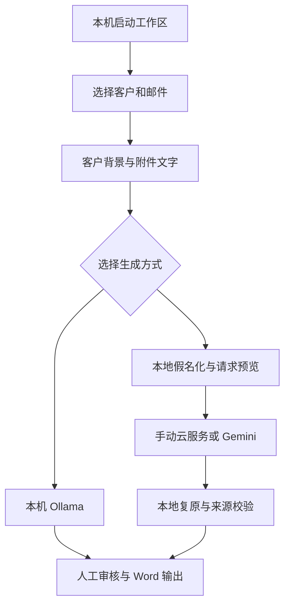

# Eml：本地运行、可选云模型与可逆假名化

研究与代码核对日期：2026-11-03（Australia/Sydney）。该实现最初基于 `main` 的
`f26e55c` 开发，现已合入 `main`；本说明于 2026-11-09 对照 `b89a560` 更新状态。

## 结论与适用场景

建议当前交付为老板电脑上的本地 Web 工作区：双击入口启动本机 Python，浏览器操作。
这能消除对开发者电脑、电源和端口的依赖。本地模型不是必装组件；Python 可以完成
选择、附件抽取、请求打包、替换、结果复原与 Word 输出。

| 想法 | 核对后的判断 | 本轮处理 |
| --- | --- | --- |
| GitHub Pages 托管完整 App | Pages 提供静态 HTML/CSS/JS，不能运行当前 Streamlit/Python；现有 Desktop OAuth 也不能原封不动用于远端 Web 服务 | 保留 GitHub 作为代码与文档来源，增加本机启动入口 |
| 在老板电脑本地启动 | 适合目前单人或少量员工使用，避免共享服务器上的客户数据隔离问题 | Mac/Windows 启动脚本、独立数据目录、显式迁移 |
| 不先经过 local LLM，直接将选定证据交给云模型 | 可行，确定性 Python 处理已经足够准备结构化输入 | 手动 JSON 交换与 Gemini 两条云入口 |
| 改名后云端就不知道客户是谁 | 不能据此保证；行业、地址、交易事实、日期和关联关系可能重新识别客户 | 可逆假名化、完整发送预览、客户默认 local-only |
| 免费 Gemini 用来处理真实邮件 | 免费服务的数据使用条款与机密客户资料不匹配；Workspace Limited Use 还限制通用模型训练用途 | Gemini 入口要求用户确认获准的 billing-enabled 项目，不自动判断或开启计费 |
| 保存模板以后复用 | 有价值；模板保存表达偏好和替换规则，不能将历史模板当成本期工作证据 | 每客户保存输出偏好、额外替换规则和本地处理设置 |

Pages 本身并不是所有浏览器端 Gmail 应用的技术障碍：完全重写为浏览器应用可以采用
适合 Web 的 OAuth，但那是另一套实现，还需处理令牌、模型密钥和使用政策。
只把当前 HTML 入口放到 Pages、继续调用开发者电脑的端口，不能解决持续性问题。
真正多人在线版本需要持续运行的后端、Web OAuth、用户身份、客户访问控制和数据隔离；
当前程序没有这些能力，不应直接开放到公网。

## 当前实际路径



| 部分 | 技术与文件 | 当前选择及原因 |
| --- | --- | --- |
| 用户界面 | Python、Streamlit；`client_workspace.py`、`workspace_panels.py` | 沿用现有三步邮件工作区，无需重写 React/Electron |
| 本机启动 | `Launch.command` / `Launch.cmd`、`helpers/launch_local.py` | 只监听 `127.0.0.1`，代码不自动更新，运行数据可放在代码目录以外 |
| Gmail 登录 | Google Desktop OAuth、`gmail.readonly`；`eml_core/auth.py` | 沿用上传 credentials 与浏览器登录；不是远端 Web OAuth |
| 选邮件 | Gmail API、IMAP 文件夹对应的标签 ID；`mailbox.py`、`folders.py`、`search.py` | 保留文件夹、多选、排除、分页、日期、客户搜索和来源范围 |
| 附件 | pypdf、python-docx、openpyxl、csv；`attachments.py` | 复用本机抽取，传文字及可追踪位置；不发送二进制附件 |
| 客户记忆 | SQLite；`profiles.py`、`documents.py` | 人工确认的客户档案和选定文档参与理解；背景并非工作完成证据 |
| 本机模型 | Ollama HTTP API；`eml_core/ai.py` | 原有背景理解与草稿流程保留，云端生成不依赖它 |
| 假名化 | Python regex、人工字面规则；`eml_core/privacy.py` | 轻量可读，不新增 NLP 模型依赖；不是完备的 PII 检测器 |
| 云交换 | Pydantic、JSON Schema；`invoice/exchange.py` | 可导出请求、导入 JSON；包 ID 和摘要用于发现结果串包 |
| Gemini | 固定 HTTPS `generateContent` REST；`eml_core/gemini.py` | 官方 API、结构化输出；不新增 SDK、不启用工具、不自动重试 |
| 本地模板 | `invoice/templates.py`、`prompts/billing_style.md` | 按客户保存表达偏好和替换规则；默认文件可改，已保存客户设置独立 |
| 审核与 Word | 原有 validator、DraftStore、python-docx renderer | 云结果复原后复用相同引用校验、人工编辑、快照与导出 |
| Outlook | 原有 AppleScript 与 FastAPI bridge | 仍是可选入口；主工作区直接调用 Python 服务，不经过 FastAPI |

## JSON、映射与证据边界

本地完整快照保留客户档案、来源、所选邮件、附件抽取、日期及原始 ID，供审核和恢复使用。
云端请求采用字段白名单：语言、输出偏好、精简客户事实、所选背景、所选邮件内容及附件文字。
不带 Google 授权、原始邮箱账号、搜索表达式、排除邮件列表、资料审核记录或原始文件指纹。

云端仍能看到保留的业务内容和日期。姓名、确认的实体名、联系人、常见邮箱/网址/号码以及
用户额外登记的字面值会被替换。文件名改成通用名称；邮件 ID、附件 part ID、文档 ID 与
文字位置改为包内 token。映射表始终属于本地对象，下载请求和 Gemini 调用都不含映射表。

例如在界面填写：

```text
ANZ => BANK
Example Pty Ltd => ENTITY
12 Example Street => ADDRESS
```

实际 token 带随机包命名空间，保留 BANK/ENTITY 等语义。同一包内相同拼写复用 token，
不同包使用不同命名空间，以减少跨包关联。大小写变体可使用不同 token，以保证引用恢复时
保留原始拼写；这不是企业实体消歧系统。规则按最长重叠优先处理，避免替换公司简称后
留下半个邮箱地址。正则常量集中在 `privacy.py`；界面只接受字面替换，避免执行任意用户正则。

返回结果必须符合 `ExchangeResponse` schema，并回填该请求的包 ID 和证据摘要。
本机检查是否对应同一个保存快照，拒绝未知 token，做一次性精确复原，再逐条核对
邮件 ID、附件 part ID、位置和引用原文。不能匹配的结果不会进入已保存草稿。
这些检查证明来源位置与引用相符，不证明模型理解正确、完成状态正确或该项可以收费。

请求及快照超过当前 1 MB 请求上限会明确失败，不静默截断。附件原有文件大小、总量、
文本长度限制仍生效。图片、扫描页、复杂表格及未计算公式的限制也继续保留。

## 开源与官方资料给出的约束

**Presidio** 的 recognizer/operator 分层、可逆替换及本地映射示例适合参考；它也明确说明
自动识别不能保证发现全部敏感信息。本轮采用同类的“识别→替换→本地复原”思路，
没有复制其代码，也没有把完整 Presidio/spaCy 模型引入这个小项目。
若以后客户量和未知实体明显增加，可基于同一个请求包边界引入 Presidio/NER，
仍须实测英文/中文公司、澳洲标识符及假阴性；安装一个库本身不构成安全保证。

**OAIC** 的指引要求结合释放环境和重新识别风险评价去标识化；删除名字不是充分条件。
因此本轮将可逆替换称为假名化，不称为匿名化。高密客户可以一直保持 local-only，
无需为了生成草稿而转云。

**Gemini** 现行条款区分 unpaid 和 paid services。免费服务可能把提交内容和输出用于
改进产品，并可能由人工处理；机密、敏感和个人资料不应提交。Gemini API 的 paid
身份取决于所用 Cloud 项目关联有效 Billing，而不是邮箱地址写着 Workspace。
Paid 服务不用于产品训练，并不等于零保留或必定在澳洲处理。

**Google Workspace API Limited Use** 限制 API 数据及其衍生用途，尤其限制为通用模型
训练、改进而转用数据。我的工程判断是：真实 Gmail 证据不应通过免费训练型服务这条
路径处理，不能把 regex 改名当成绕过政策的理由。手动上传云服务也需要核对相同边界。
本轮 UI 只能记录操作者声明，不能通过一个 API key 自动验证 Billing 状态或合同条款。

**TPB(GS) 55/2026** 专门讨论税务执业中的 AI：向第三方披露客户事务通常要取得客户许可，
且应审核模型输出、保留判断记录。该义务涉及客户事务，不只涉及个人姓名。
因此收费记录助手有实际用途，但接入付费 API 或替换名称本身不能代替事务所的许可与供应商审查。
软件默认 local-only；现有人工审核、引用及工作状态区分继续保留。

## 模板与“学习 invoice”

本轮模板是可编辑的生成偏好、规则和背景，属于可复用配置。它没有训练/微调模型，
也不会因为一份旧 invoice 有 BAS 描述，就认定本月完成 BAS。
历史收费文件若作为参考上传，应说明是表达或分组示例，避免不必要的金额和客户信息。
当前 Word 外观仍由已有 `invoice/renderer.py` 控制；没有新增任意 DOCX 模板引擎。

## 版本与尚未验证的内容

本轮只对原生成服务/UI 加可选入口，新增独立模块和 SQLite 表，不重建旧表、不改既有字段。
没有修改文件夹读取、搜索语义、原 `app.py`、附件解析、Outlook 脚本或 Word renderer。
没有开启 Pages、公网监听、账号共享、自动合并或自动发出 invoice。

迁移时先停止程序、备份完整本地数据，再换代码版本。新表可以与旧版本共存；旧版本不展示
新增云功能，但保留的数据仍在。回退代码不撤销发到云端的数据，也不替代数据库备份。

自动测试覆盖结构、隐私包、拒绝串包、来源复原、HTTP 适配和 UI；并不代表已验证真实
Gemini 账号/模型质量、老板 Gmail 授权、Mac/Windows 快捷入口或 Outlook 安装兼容性。
正式交接还需用脱敏样本在目标电脑完成一轮，并确认数据目录备份与公司 Google 项目的管理人。

本轮验证：131 项 unittest（包括 Streamlit AppTest）全部通过，无跳过；独立启动器在
Linux 容器中成功启动并返回 loopback health=ok，随后正常停止；启动器修复后其相关测试
再次通过。环境为 Python 3.12.14、Streamlit 1.66.1、Pydantic 2.14.1。
Gemini 使用合成响应检查 endpoint、header、schema、配额错误、阻断/截断与不重试行为，
没有用真实 API key 或客户资料进行云调用。当前 requirements 保留上游范围，未声称完整
依赖锁定；交接时宜记录目标电脑实际安装版本。

## 主要资料

- [GitHub Pages：创建站点与服务端语言限制](https://docs.github.com/en/pages/getting-started-with-github-pages/creating-a-github-pages-site)
- [GitHub Pages 使用限制](https://docs.github.com/en/pages/getting-started-with-github-pages/github-pages-limits)
- [Gemini API terms](https://ai.google.dev/gemini-api/terms)
- [Gemini API pricing](https://ai.google.dev/gemini-api/docs/pricing)
- [Gemini structured outputs](https://ai.google.dev/gemini-api/docs/structured-output)
- [Gemini generateContent REST reference](https://ai.google.dev/api/generate-content)
- [Workspace API user data and developer policy](https://developers.google.com/workspace/workspace-api-user-data-developer-policy)
- [Gmail scopes](https://developers.google.com/workspace/gmail/api/auth/scopes)
- [Restricted-scope verification 与例外](https://developers.google.com/identity/protocols/oauth2/production-readiness/restricted-scope-verification)
- [OAuth refresh token 失效条件与 Testing 的七天限制](https://developers.google.com/identity/protocols/oauth2)
- [Presidio 功能、限制及可逆操作](https://microsoft.github.io/presidio/)
- [Presidio anonymizer](https://microsoft.github.io/presidio/anonymizer/)
- [Presidio 本地映射示例讨论及样例链接](https://github.com/data-privacy-stack/presidio/discussions/1118)
- [OAIC：De-identification and the Privacy Act](https://www.oaic.gov.au/privacy/privacy-guidance-for-organisations-and-government-agencies/handling-personal-information/de-identification-and-the-privacy-act)
- [TPB(GS) 55/2026：AI 与 Code of Professional Conduct](https://www.tpb.gov.au/tpbgs-552026-use-artificial-intelligence-and-code-professional-conduct)
