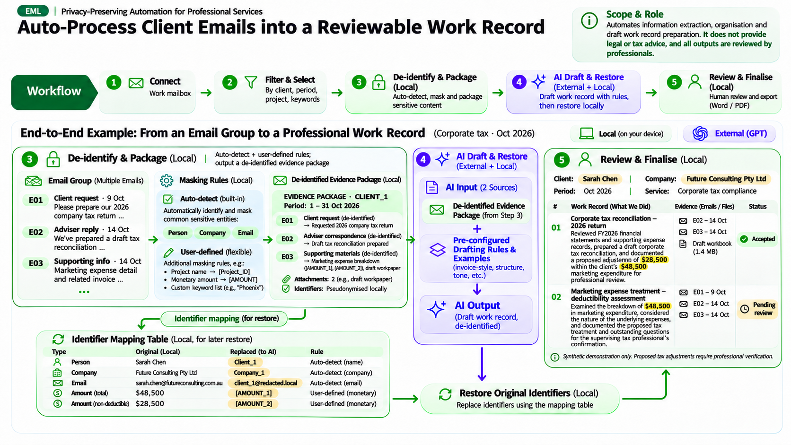
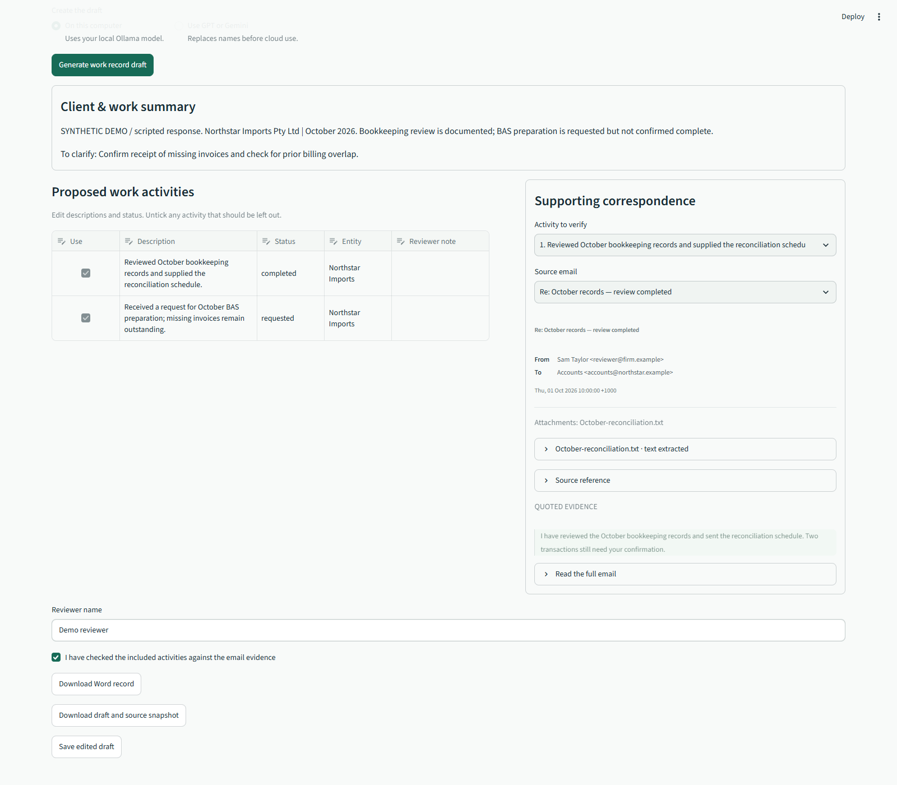
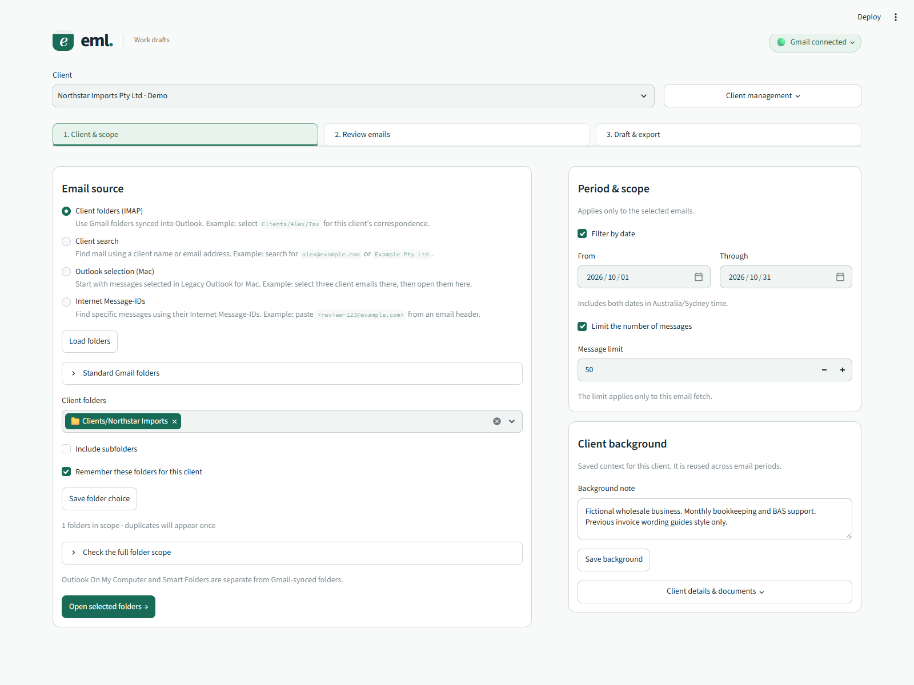
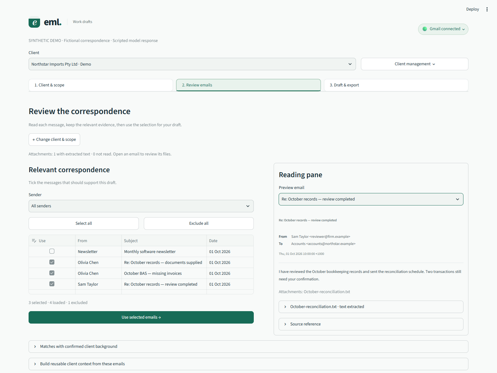
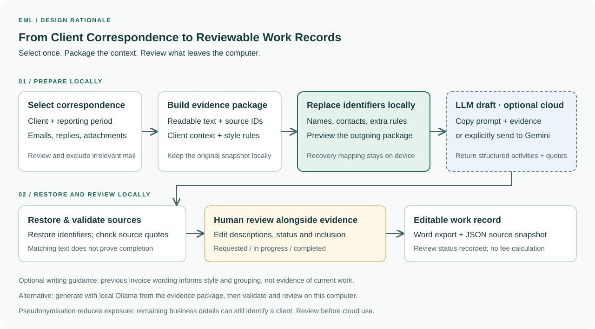

# Eml · From client emails to professional work records

Turn selected client correspondence into a detailed, evidence-backed work-record
draft for professional review.

The workflow below defines the target product experience. Screenshots show the
current prototype.

- **Local privacy controls** — detect common identifiers, refine masking rules
  and review the pseudonymised package before cloud drafting; keep original files
  and recovery mappings on device.
- **Professional service descriptions** — organise the work, adjustments and
  deliverables into a billing-style draft with supporting sources.
- **Reviewer control** — edit wording, inclusion and work status before final use.

## Product workflow

[](docs/assets/eml-professional-workflow.png)

[Open the full-size workflow](docs/assets/eml-professional-workflow.png).
Synthetic illustration of the intended workflow, not a live model result or an
application screenshot. The example amounts and proposed adjustments are fictional.

1. **Connect and select** — choose the client, period and relevant emails and attachments.
2. **Detect and mask locally** — identify names, companies and contact details;
   add rules for project names, amounts and other sensitive content.
3. **Review the outgoing package** — inspect replacements and keep the recovery
   mapping on device.
4. **Draft and restore** — use cloud AI as the primary drafting route, with the
   pseudonymised evidence and professional writing rules; restore identifiers locally.
5. **Review and finalise** — confirm each service, its supporting evidence and
   review status, then export a professional Word or PDF work record.

## Inside the workspace

These screenshots show the **actual Streamlit interface**, using a fictional
client, synthetic emails and a scripted model response.

### Review the draft and its evidence

Check proposed services alongside supporting quotations, edit the record and
export an editable Word document with a JSON source snapshot.



### Choose the client and period

Set the client, reporting period and correspondence source.



### Keep only relevant correspondence

Inspect emails and attachments, exclude irrelevant messages and retain the
selected evidence for drafting.



The interface walkthrough uses **Northstar Imports**, a separate synthetic case
from the workflow illustration. [Reproduce these captures](docs/portfolio_capture.md).

## Why I built it

Preparing service records meant assembling evidence scattered across emails,
replies and attachments, then translating it into professional billing language.
Eml brings selection, local privacy preparation, source-linked drafting and review
into one workspace. Previous invoice wording can guide style; current
correspondence must support the work described.

<details>
<summary>Compact workflow</summary>



</details>

<details>
<summary>Privacy and professional review</summary>

- Pseudonymisation reduces exposure; it does not guarantee anonymity. The reviewer
  checks the outgoing package, including identifying business context.
- Source references support review; they do not establish that work was completed
  or is billable. Professional judgement stays with the reviewer.
- Eml prepares work-record drafts. It does not infer hours or fees, issue invoices,
  or provide tax or legal advice.

[Architecture and data boundaries](docs/local_cloud_architecture.md)

</details>

## Try the synthetic walkthrough

Install the requirements and launch the isolated demo:

```bash
python -m pip install -r requirements.txt
python -m streamlit run helpers/portfolio_demo.py --server.address 127.0.0.1 --server.port 8517 --server.headless true
```

Select the **Northstar** folder, review the correspondence, then choose
**On this computer → Generate work record draft**. The demo uses a temporary
database and scripted responses; no Gmail sign-in or model server is needed.

For the working application, follow the [local installation guide](docs/local_install.md)
and [Gmail setup](docs/gmail_setup.md).

## Built with

Python · Streamlit · Gmail read-only API · SQLite · local attachment extraction ·
structured model exchange.

The Streamlit workspace calls shared Python services directly. An optional
Outlook bridge is available as a separate entry point.

- [Workspace user guide](docs/workspace_guide.md)
- [Local installation](docs/local_install.md)
- [Architecture and data boundaries](docs/local_cloud_architecture.md)
- [Gmail setup](docs/gmail_setup.md)
- [Demo and screenshot reproduction](docs/portfolio_capture.md)
